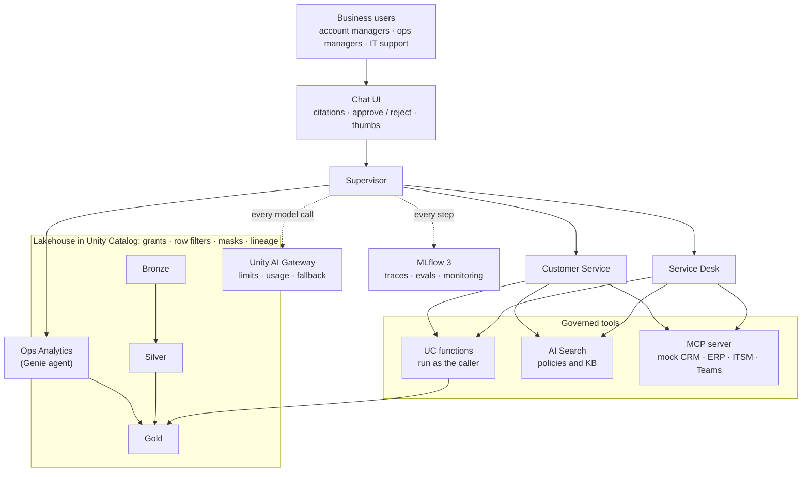

# Sanad

A governed multi-agent copilot built end to end on Databricks. Raw CRM, ERP and service-desk data goes in. Agents that are evaluated, monitored and permission-aware come out, and a human approves every write they propose.

Sanad serves **Najm Supply Co.**, a fictional B2B distributor in Riyadh. All data is synthetic. It comes from a seeded generator, so the evaluation has a known ground truth.

## What it does

An account manager asks:

> "Why was Al-Faris Trading invoiced twice in September, and is their shipment late?"

1. The **supervisor** routes the question to the **Customer Service** specialist.
2. Customer Service calls Unity Catalog functions **as the asking user**, so row filters and PII masks apply to the agent too. It finds the duplicate invoices `INV-027711` and `INV-050001`, checks the shipment, and retrieves the credit-note policy `fin-duplicate-invoices`.
3. The answer comes back in a fixed schema with **citations** (records and documents) and a confidence level.
4. The agent proposes a **credit note**. The run pauses until a human approves. The mock ERP then holds the draft for the approver the policy names for that amount.

Every step is an MLflow trace. A 33-case evaluation set, red-team cases included, checks this behaviour before any change can deploy.

## Architecture



See [docs/architecture.md](docs/architecture.md) for the full diagram and the rules the design depends on.

## What it demonstrates

| Capability | Where to look |
|---|---|
| Medallion pipeline with data-quality expectations, triggered when files arrive | [pipelines/](pipelines/), [ADR 0002](docs/adr/0002-trigger-pipeline-on-file-arrival.md) |
| Grants, row filters, PII column masks, tags and an audit query | [governance/](governance/), [access matrix](docs/access-matrix.md) |
| Retrieval: three chunking strategies compared on 120 queries, then one chosen | [retrieval/](retrieval/), [ADR 0003](docs/adr/0003-retrieve-whole-documents-with-ai-prep-search.md) |
| Agent tools run with the asking user's permissions, not the app's | [tools/](tools/), [ADR 0004](docs/adr/0004-run-tools-as-the-asking-user.md) |
| Supervisor with specialists as tools; human approval on every write | [agent/](agent/), [ADR 0005](docs/adr/0005-supervisor-calls-specialists-as-tools.md) |
| Idempotent, retrying MCP writes to enterprise systems | [mock_systems/](mock_systems/), [ADR 0006](docs/adr/0006-mock-systems-behind-a-custom-mcp-app.md) |
| Evaluation: code scorers plus LLM judges from a different model family, and a red-team gate in CI | [evals/](evals/), [ci.yml](.github/workflows/ci.yml) |
| Success-metric dashboards, a runbook and a game day | [monitoring/](monitoring/), [runbook](docs/runbook.md) |

## Results

From MLflow evaluation runs ([agent card](docs/agent-card.md)):

| Run | Correctness | Groundedness | Safety | PII leaks | p90 latency | Tokens per question |
|---|---|---|---|---|---|---|
| baseline | 0.933 | 0.950 | 0.962 | 0 | 45 s | 9,135 |
| gate-check-1 (4 workers) | 0.875 | 0.955 | 1.000 | 0 | 72.3 s | 10,801 |

Gate check 1 passed every quality and safety floor. Some gaps are open, and each is written down:

- p90 latency was above the 60 s ceiling on a slow-gateway day.
- Traces from the deployed app have no spans.
- The CI red-team gate is skipped until the repo has a Databricks service principal.

See [known limitations](docs/agent-card.md#known-limitations).

## Status

| Phase | Goal | Gate |
|---|---|---|
| 0 Discovery | Decide what to build and why | |
| 1 Lakehouse | Synthetic data to clean bronze, silver and gold tables | |
| 2 Governance | Control who sees what, and prove it | |
| 3 Documents | Prepare policies and KB articles for retrieval | |
| 4 Agent | Agents that use tools and apply business rules safely | Gate A passed |
| 5 Integrations | Connect the agents to enterprise systems through MCP | |
| 6 Evaluation | Measure quality, cost and safety before shipping | G2 accepted with 2 exceptions |
| 7 Polish | Chat UI, dashboards, runbook, deploy from CI | G3 accepted with exceptions |
| 8 Enablement | Agent template, walkthrough, demo scripts | |

All nine phases are done. The [learning log](docs/learning-log/) records each phase: what was built, the mistakes and the decisions.

**Stack:**

- **Databricks (Free Edition):** Lakeflow declarative pipelines and jobs, Unity Catalog, AI Search, Genie, Databricks Apps, Unity AI Gateway, MLflow 3, and Declarative Automation Bundles.
- **Agent:** LangGraph, run with the Agent Bricks CLI.
- **Mock systems:** FastAPI and MCP.
- **Tooling:** Python 3.12, uv, ruff, pytest and GitHub Actions.

## Repository map

| Folder | What's in it | Phase |
|---|---|---|
| [docs/00-discovery/](docs/00-discovery/) | Use-case canvas, roadmap, job description | 0 |
| [data_gen/](data_gen/) | Synthetic CRM, ERP and ITSM data with seeded problems | 1 |
| [pipelines/](pipelines/) | Lakeflow pipeline: bronze, silver, gold | 1 |
| [governance/](governance/) | Grants, row filters, column masks, tags, audit (SQL) | 2 |
| [retrieval/](retrieval/) | Corpus, chunking, index, retrieval evaluation | 3 |
| [tools/](tools/) | Unity Catalog functions the agents call | 4 |
| [agent/](agent/) | Agent Bricks project: `agent.toml`, LangGraph graph, prompts, schema, chat UI | 4, 5, 7 |
| [genie/](genie/) | The Ops Analytics Genie agent's definition | 4 |
| [mock_systems/](mock_systems/) | FastAPI mock CRM, ERP, ITSM and Teams, plus the MCP server | 5 |
| [evals/](evals/) | Cases, scorers, red-team set, `run_eval.py` | 6 |
| [monitoring/](monitoring/), [dashboards/](dashboards/) | Success-metric tables and AI/BI dashboards | 7 |
| [tests/](tests/) | Unit and integration tests (the agent has its own in `agent/tests/`) | every phase |
| [databricks.yml](databricks.yml) | Bundle: pipeline, job, mock-systems app, dashboards, Genie space, AI Search | 1–7 |

## Run it

### Without Databricks

These need only [uv](https://docs.astral.sh/uv/) and Python 3.12:

```bash
uv run pytest                          # data generator, eval checks, retrieval, mock systems, MCP server
(cd agent && uv run pytest)            # agent graph, answer schema, runtime, chat UI
uv run python data_gen/generate.py --out data_gen/output --seed 42   # about 166k synthetic rows

# Mock CRM, ERP, ITSM and Teams on :8100, with the MCP server on :8200
docker compose -f mock_systems/compose.yaml up --build -d
```

### On a Databricks workspace

The commands assume a CLI profile named `sanad` (`databricks auth login --profile sanad`). Each step links to the README that has the details.

1. Create the catalog, schemas and landing volume: run [pipelines/setup.sql](pipelines/setup.sql) in the SQL editor.
2. Generate the data and upload it: `databricks fs cp -r data_gen/output dbfs:/Volumes/sanad/bronze/landing --profile sanad`.
3. Create the three account groups, then run [governance/setup.sql](governance/setup.sql) ([governance README](governance/README.md)).
4. Deploy and run the bundle: `databricks bundle deploy --profile sanad`, then `databricks bundle run sanad_medallion --profile sanad`.
5. Build the document corpus and run [retrieval/chunks.sql](retrieval/chunks.sql) ([retrieval README](retrieval/README.md)).
6. Create the agent tools: run [tools/functions.sql](tools/functions.sql) ([tools README](tools/README.md)). The managed MCP servers preview must be on.
7. Register the prompts, start the app compute, and deploy the agent ([agent README](agent/README.md), [runbook](docs/runbook.md)).

> **Replace these with your own workspace's values.** None of them is a secret, but they point at the original workspace:
> - `agent_sp` in [databricks.yml](databricks.yml)
> - the experiment and service-principal IDs in [agent/app.yaml](agent/app.yaml)
> - the Genie `space_id` in [agent/agent.toml](agent/agent.toml)
>
> Workspace hosts and credentials never live in the repo: the CLI profile or CI secrets supply them.

## Docs

- [Scenario and agents](docs/scenario.md): who Sanad serves, the four agents, the synthetic data and its seeded problems
- [Architecture](docs/architecture.md): layers, data flows, governance rules
- [System tour](docs/system-tour.html): an animated, chapter-by-chapter walk through the whole system. Download it and open it in a browser.
- [Agent card](docs/agent-card.md): purpose, tools, data, limits, latest evaluation scores
- [Decision records](docs/adr/) · [Runbook](docs/runbook.md) · [Access matrix](docs/access-matrix.md) · [Success metrics](docs/success-metrics.md)
- [Agent template](docs/agent-template.md) · [30-minute walkthrough: add a tool](docs/walkthrough.md) · [Demo scripts](docs/demo-scripts.md)
- [Skill coverage](docs/skill-coverage.md): each line of the target job description, mapped to evidence in this repo
- [Learning log](docs/learning-log/) and the [consolidated learning guide](docs/learning-log/sanad-learning-guide.html)

## How it was built

Sanad is a portfolio project for a Senior AI Agent & Databricks Lakehouse Engineer role. It was built with [Claude Code](https://claude.com/claude-code) in its Learning output style. [CLAUDE.md](CLAUDE.md) sets the rules for that work.

From Phase 3 on, Claude also wrote the judgement calls: business rules, prompts and thresholds. The learning log marks each of these as Claude-written, so the owner knows which ones to be ready to defend. Each task followed the same loop:

1. Read first.
2. Plan.
3. Build.
4. Break it on purpose.
5. Explain it back (`/explain-back`).
6. Record it (`/adr`).

## License

[MIT](LICENSE)
