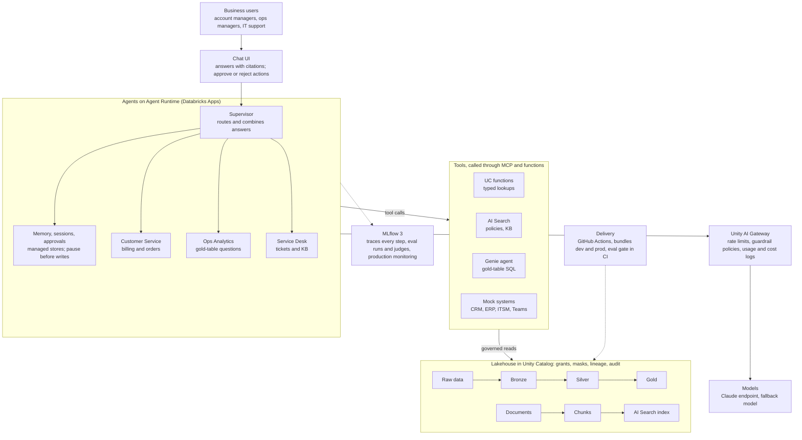

# Architecture

Agents reach data only through governed tools and one gateway. Sanad has four layers: the Lakehouse (Phases 1 to 3), tools and agents (Phases 4 and 5), and the user experience (Phase 7). The gateway, MLflow and the delivery pipeline run alongside every layer.

Requests flow top to bottom. Lakeflow pipelines build the data from the bottom up.

## Rules the design depends on

- **One gateway.** Every model call passes through Unity AI Gateway, so rate limits, guardrails and cost attribution apply to all of them.
- **Every step traced.** MLflow traces every routing decision, tool call and retrieval. That is what makes the agent auditable.
- **No direct table access.** Agents call tools, and the tools run under Unity Catalog permissions. Grants, row filters and column masks therefore apply to the agent too.
- **Writes wait for a human.** Every write action (credit note, ticket, Teams post) pauses on a LangGraph interrupt for approval.
- **Beta features are isolated.** Agent logic lives in plain LangGraph modules, and the Databricks serving layer stays thin. See [ADR 0001](adr/0001-isolate-beta-features.md).
- **Retrieval filters by metadata.** AI Search has no row or column security, so retrieval passes the user's department or region as a filter.

## Unity Catalog layout

One catalog, `sanad`, with five schemas.

| Schema | Holds | Built in |
|---|---|---|
| `bronze` | Raw ingested CRM, ERP and ITSM data (Auto Loader) | Phase 1 |
| `silver` | Cleaned, conformed tables with expectations | Phase 1 |
| `gold` | Business tables: `customer_360`, `invoice_issues`, `delivery_sla_by_region`, `ticket_trends` | Phase 1 |
| `ai` | Parsed document elements, `chunks`, the AI Search index source, UC function tools | Phases 3, 4 |
| `ops` | Audit queries, evaluation results, monitoring tables | Phases 2, 6, 7 |

## Data flows

Filled in during Phases 1 and 3: the ingestion path from generator to gold, and from documents to index.

## Identity and auth

Filled in during Phases 2 and 7: groups, service principals, app authorization versus on-behalf-of-user authorization.
